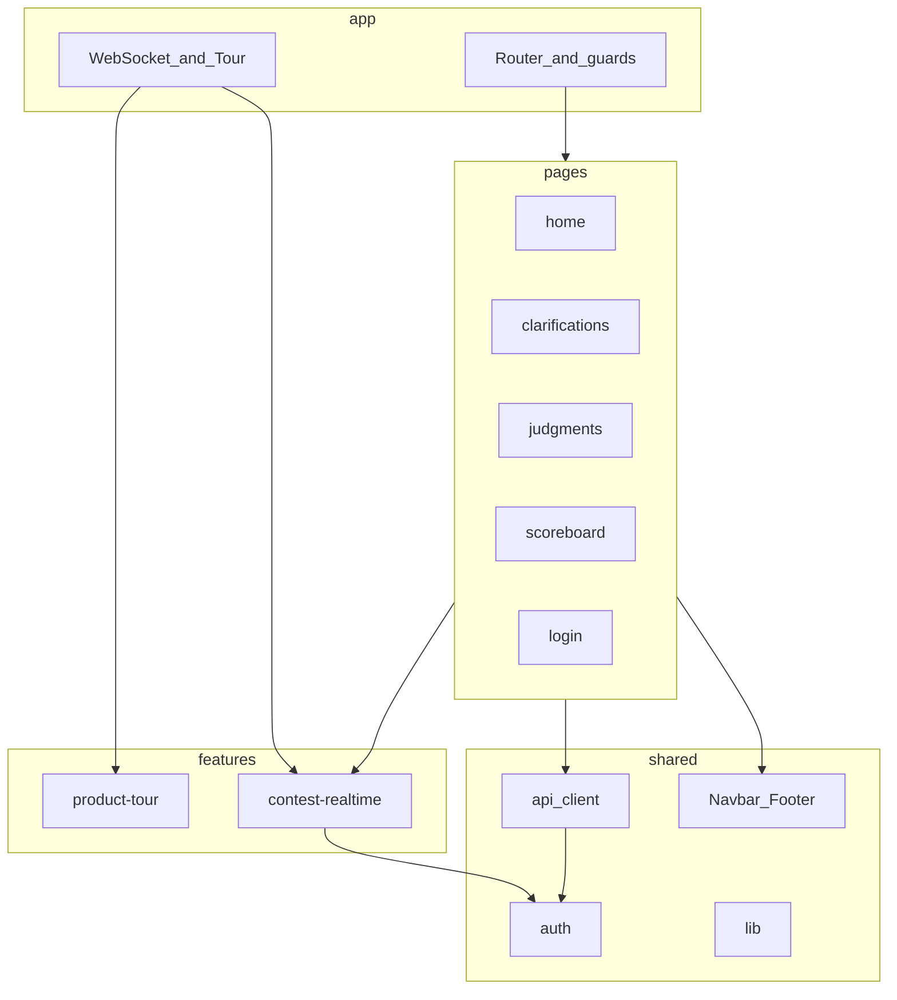

# Architecture

Living reference for the WCF (Web Code Flow) team contest frontend (`wwffrontend`). Update this file when structure, boundaries, or API contracts change so new features stay consistent.

## Product

Team-facing SPA for collegiate programming contests. Talks to **wwfapi** (Jetty/Jersey façade over PC²):

| Concern | Detail |
|---------|--------|
| Auth | HttpOnly JWT cookie `awt_jwt` + CSRF token in `localStorage` (`X-CSRF-Token`) |
| REST | `/api/main/*` (session, login, problems, languages, getwspath), `/api/team/*` (runs, clarifications, scoreboard) |
| Realtime | WebSocket (path from `GET /api/main/getwspath`, default `/ws/contest`) |
| Env | Local `localhost:3000`: leave `VITE_API_URL` / `VITE_WS_URL` empty; Vite proxies `/api`+`/ws` to `VITE_PROXY_TARGET`. Production: leave empty (same-origin). Codes: [`error-documentation.md`](./error-documentation.md). |

Active routes (HashRouter): `/` login, `/home`, `/clarifications`, `/judgments`, `/scoreboard`.

## Stack

- React 19 + **Vite 6** (`vite`, `@vitejs/plugin-react`)
- React Router 6 (`HashRouter`)
- **Tailwind CSS v4** (`@tailwindcss/vite`, CSS-first `@theme` + class dark mode via `features/theme`)
- react-icons
- Design docs: [`app_colors.md`](./app_colors.md), [`app_theme.md`](./app_theme.md), [`dark-mode.md`](./dark-mode.md)
- **Vitest** + Testing Library (characterization / contract tests)
- **TypeScript** across the whole `src/` tree (app, pages, features, shared, tests)
- Path aliases: `app`, `pages`, `features`, `shared` (see `vite.config.js` / `tsconfig.json`)
- Production output: `build/` (same as CRA, keeps GitLab rsync deploy path)

### Scripts

| Script | Purpose |
|--------|---------|
| `npm start` / `npm run dev` | Vite dev server (port 3000) |
| `npm run build` | `tsc --noEmit` then `vite build` → `build/` |
| `npm test` | `vitest run` |
| `npm run typecheck` | TypeScript only |

### Env migration note

Old CRA vars `REACT_APP_*` were renamed to `VITE_*`. Update local `.env` and any CI/CD env vars accordingly.

## Layout (pragmatic feature-based / light FSD)

```text
src/
  app/                    # Shell: router, providers wiring, route guards
  pages/                  # Route screens (UI + colocated CSS + data hooks)
    login/
    home/
    clarifications/
    judgments/
    scoreboard/
  features/
    product-tour/         # First-login guided tour (self-contained)
    contest-realtime/     # WebSocket provider + split clock/connection/notifications
  shared/
    api/                  # Typed HTTP client, endpoints, domain modules, DTO normalize
    auth/                 # localStorage auth helpers (preserve tour keys on logout)
    ui/                   # Navbar, Footer
    lib/                  # formatTime, fileToBase64, …
    config/               # Env URL normalization
  index.jsx
  index.css
```

### Layer rules

| Layer | May import from | Role |
|-------|-----------------|------|
| `app` | pages, features, shared | Compose routes and global providers |
| `pages` | features, shared | One route = one folder; keep markup/CSS behavior stable |
| `features` | shared | Cross-cutting user flows / realtime |
| `shared` | (itself only) | Domain-agnostic utilities and API |

- Prefer **co-location**: page CSS, hooks, and page-only helpers live next to the page.
- Export a public surface via `index.js` / `index.ts` barrels when a folder is imported from outside.
- Do **not** revive deleted dormant pages (Training, Settings, Dashboard, Balloons, Contact) unless product asks.



## Shared API (TypeScript)

- **`apiClient`**: `credentials: "include"`, optional CSRF, JSON body once.
- **Domain modules**: `authApi`, `problemsApi`, `runsApi`, `clarificationsApi`, `scoreboardApi`.
- **Types**: `shared/api/types.ts` mirrors wwfapi DTOs.
- **Normalization**: backend `listProblems.alphabte` → client `shortName` (display/scoreboard). Submit and clarification payloads must send PC² **display name** (`name` / `IProblem.getName()`); wwfapi `ProblemResolver` matches `getName()` only. Clarification payloads keep PascalCase (`ProblemName`, `Question`, …).
- Pages/hooks call domain modules; do not hand-roll `fetch` to contest endpoints.

## Auth & session

- Login stores `isLoggedIn` in sessionStorage (this tab) and mirrors `username` / `displayName` / `csrfToken` to localStorage so a **new tab** can hydrate after the JWT cookie passes `GET /session`.
- `GET /api/main/session` returns only `{ authenticated, message }` — display name / CSRF come from that login cache, not the session payload.
- Logout: best-effort `DELETE`, **always** clear auth keys, navigate to `/`.
- Forced WS `LOGOUT_REQUIRED`: clear auth and set hash to `#/`.
- Product-tour keys (`acpc:product-tour:*`) must survive logout. Walkthrough: [`docs/tutorial.md`](./tutorial.md).

## Realtime (`features/contest-realtime`)

`WebSocketProvider` owns the socket. State is split so the 1s clock tick does not re-render unrelated consumers:

| Hook | Provides |
|------|----------|
| `useContestConnection` | `socket`, `ready`, `scoreboard` |
| `useContestClock` | `timeLeft`, `isRunning`, `hasInitialData`, `elapsedSeconds`, `contestLengthSeconds` |
| `useContestNotifications` | bell feed + setters |
| `useWebSocket` | combined (prefer split hooks) |

WS message shapes live in `features/contest-realtime/types.ts`.

### WebSocket URL resolution

The WebSocket path is fetched from the backend via `GET /api/main/getwspath` (returns `{ socketPath: "/ws/contest" }`). This is controlled by the backend's `pc2v9.ini` setting `wwfWSPath`. The frontend caches the result per page load.

**Precedence:**
1. `VITE_WS_URL` env override (for debugging/emergencies)
2. Backend path from `/getwspath`
3. Fallback `/ws/contest` (for older backends or network errors)

If a socket fails to connect (never opens), the cached path is invalidated and refetched on the next reconnect attempt. This handles backend restarts that change the path.

**Dev proxy note:** Vite only proxies paths starting with `/ws`, so during local development the backend's `wwfWSPath` must start with `/ws/...`.

Pages may still poll REST as fallback (Home ~10s catalog, Judgments ~5s runs).

## Adding a feature (checklist)

1. **New screen** → `src/pages/<name>/` + route in `app/App.jsx` + nav in `shared/ui/Navbar.jsx` if needed.
2. **New API** → `endpoints.ts`, domain module, types in `types.ts`, normalize if needed, contract test under `shared/api/__tests__/`.
3. **Cross-cutting interaction** → `src/features/<name>/` with a barrel export.
4. **Shared chrome/util** → only after two real call sites.
5. **UI/behavior** → preserve existing look unless the task is explicitly a design change.
6. **Tests** → `npm test` and `npm run build`. Prefer `.jsx`/`.tsx` for files that contain JSX.
7. **Docs** → update this file if layers, contracts, routes, or toolchain change.

## Testing

- Vitest: `npm test`
- Coverage focus: API URL/normalize, auth storage, route guards, submit payloads (display `name`), forced logout, page smokes.
- Do not commit `build/` or `.vite/`.

## Out of scope (for now)

- HashRouter → BrowserRouter
- TanStack Query / global client cache
- GitLab CI test stage (paused pending manager approval)

## Changelog (architecture-relevant)

| Date | Note |
|------|------|
| 2026-10-20 | WebSocket URL from backend `GET /api/main/getwspath`; `VITE_WS_URL` now optional override; path caching with invalidation on handshake failure. |
| 2026-08-10 | Login branded redesign + Contact Us; docs `app_colors` / `app_theme`; gold accent tokens. |
| 2026-08-10 | Removed Bootstrap + animate.css; Login converted to Tailwind. |
| 2026-08-10 | Feature feature-based layout; central API client; bugfixes; characterization tests; dead pages removed. |
| 2026-08-10 | CRA → Vite; `REACT_APP_*` → `VITE_*`; Vitest; TypeScript on `shared/api` + WS contracts; split contest-realtime contexts/hooks. |
| 2026-08-10 | Convert `app/`, `pages/`, `shared/ui`, and `shared/lib` to TypeScript/TSX (behavior unchanged). |
| 2026-08-10 | Finish TS migration: `product-tour`, tests, `setupTests`, `reportWebVitals`. No remaining JS/JSX under `src/`. |
| 2026-08-10 | Pinned `ContestLayout` sidebar; Clarifications UI refactor (submit still uses display `name` / `General`). |
| 2026-08-10 | Dark mode guide: [`docs/dark-mode.md`](./dark-mode.md). Judgments UI refresh (filter + pagination). |
| 2026-08-10 | Scoreboard → Live Standings UI (search/filter/summary/pagination); still WS + API scoreboard data. |
| 2026-08-13 | Login errors as short codes; [`docs/error-documentation.md`](./error-documentation.md). |
| 2026-08-13 | Local Vite proxy on `localhost:3000` → `VITE_PROXY_TARGET` (`/api`, `/ws`). |
| 2026-08-13 | Admin WS logoff (`4001` / `LOGOUT_REQUIRED`) and WS rate-limit (`AUTH_WS_RATE_LIMIT`). |
| 2026-08-17 | Product tutorial (first-login + Tutorials replay): [`docs/tutorial.md`](./tutorial.md). |
| 2026-08-22 | Tour expanded (clar types + scoreboard colors); list API errors surfaced; ScoreboardEmbed removed; README rewritten. |
| 2026-08-22 | WS false-logout softened; session unreachable retries; socket cleanup; standings 401/503 messaging. |
